<p align="center">
  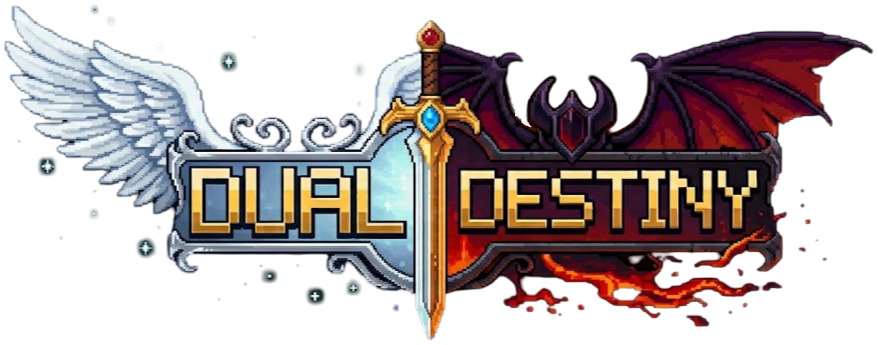
</p>

<p align="center">
  <b>RPG multijugador en pixel art · Unity 6 + Mirror · servidor propio en Node.js y MongoDB · Android y PC</b><br>
  <i>Dos planos en guerra. Un mundo atrapado en medio.</i>
</p>

<p align="center">
  
  
  
  
  
  
</p>

---

**Dual Destiny** es un RPG de acción top-down multijugador en tiempo real, un proyecto independiente hecho desde cero en
ratos libres. Ángeles y demonios no pueden enfrentarse sin destruirse… así que usan a los humanos como peones. Tú eres uno de
ellos: despiertas tu energía espiritual, nace tu **rasgo** —un poder único que solo tú tienes— y decides de qué lado cae la
balanza en **Veridia**.

Todo lo que ves aquí está **grabado del juego real** (el cliente se graba a sí mismo con un modo director propio): nada de
maquetas.

## 🎬 En acción

<table>
  <tr>
    <td align="center">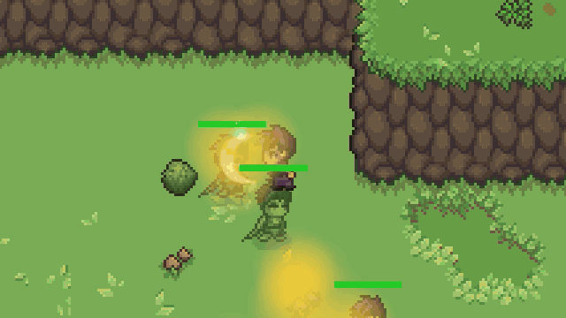<br><b>Nigromante</b> — alza las almas de los caídos y lucha con su ejército</td>
    <td align="center">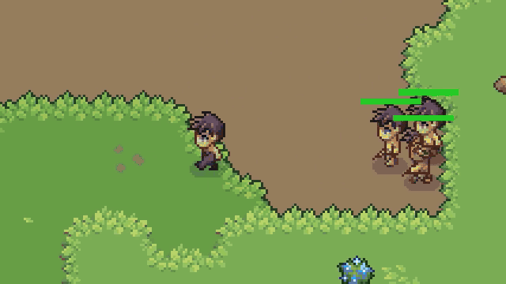<br><b>Piel de dragón</b> — los golpes rebotan… y despierta el dragón</td>
  </tr>
  <tr>
    <td align="center">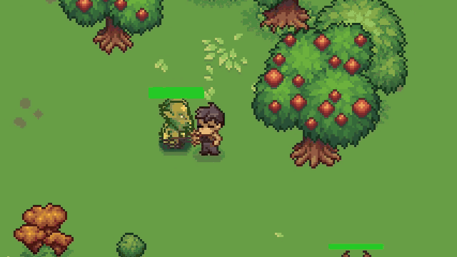<br><b>Sangre ardiente</b> — llamas cada vez más intensas y la Llama final</td>
    <td align="center">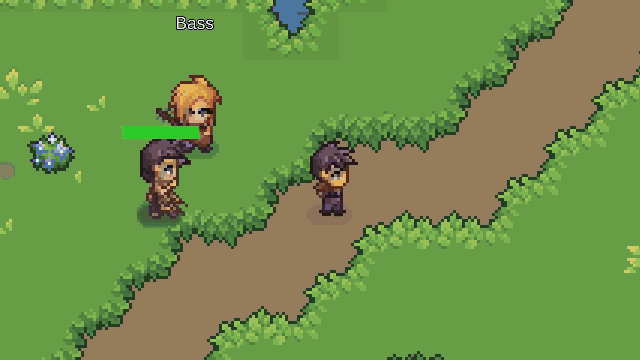<br><b>Paso de sombra</b> — desaparece y apuñala por la espalda</td>
  </tr>
  <tr>
    <td align="center">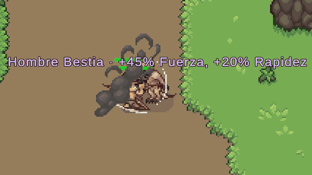<br><b>Metamorfo</b> — lo que derrotas, lo eres</td>
    <td align="center">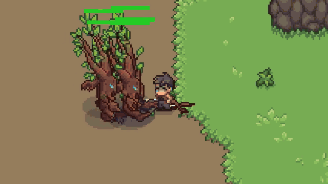<br><b>Habilidades</b> — colmillos de piedra, tornados, cometas y el rayo</td>
  </tr>
  <tr>
    <td align="center" colspan="2">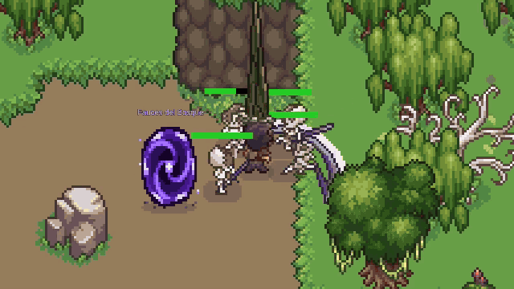<br><b>Mazmorras</b> — Fauces del Bosque, en solitario o en grupo, contra reloj</td>
  </tr>
</table>

## ✨ Rasgos: un poder que solo es tuyo

<p align="center">
  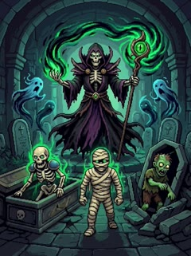
  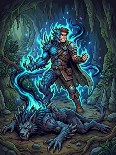
  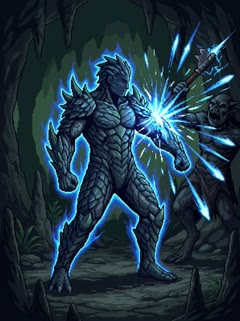
  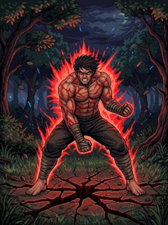
  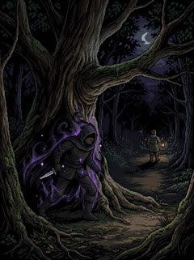
</p>

Al despertar, un orbe te ofrece tres rasgos al azar y eliges uno **para siempre**. Todos empiezan en rango **F** y pueden
llegar a **S**; cada rango desbloquea una forma nueva de luchar (subir no es suerte: es usarlo).

| Rasgo | Lo que hace |
|---|---|
| **Nigromante** | Las almas de los caídos flotan unos segundos: álzalas como esbirros, hazlos estallar, sacrifícalos para curarte y, en S, invoca a la vez a todos los que alzaste en el último minuto. |
| **Metamorfo** | Derrota 20 veces a una especie y aprende su forma: potencias tus propios atributos con su esencia (y en S, dos formas a la vez). |
| **Piel de dragón** | El escudo del grupo: escamas que reflejan el daño, coraza, rugido que provoca… y en S te conviertes en un dragón que escupe energía. |
| **Sangre ardiente** | Más daño y velocidad a cambio de tu vida, en llamas cada vez más intensas; en S, la vida que te falta estalla en una explosión. |
| **Paso de sombra** | Teletransporte de sombra en sombra, puñaladas críticas, marcas, señuelos y la Danza de sombras. |

Hay 12 rasgos diseñados (5 jugables ya) y la meta son unos 50. Además del rasgo, el resto de habilidades se consiguen
explorando: botín, misiones, logros.

<p align="center">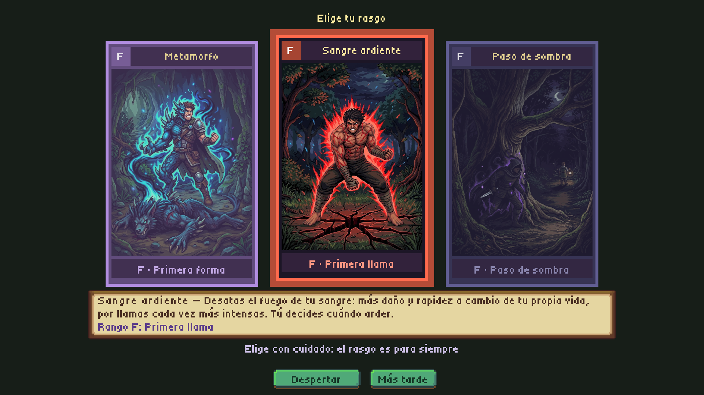<br><i>El orbe del despertar, en el juego</i></p>

## 🐉 Un mundo lleno de criaturas

<p align="center">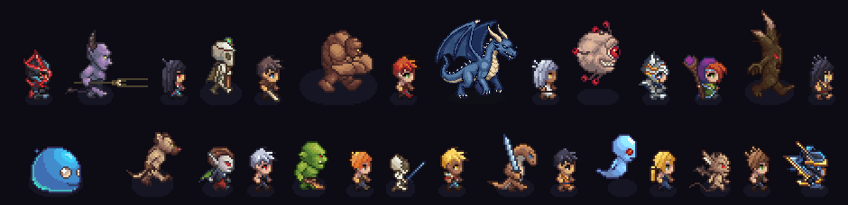</p>

Más de **180 sprites animados** en 4 direcciones (andar, atacar, herido, morir): demonios, liches, gólems, beholders,
slimes jefe, ents, vampiros, fantasmas, hombres lagarto… y **73 luchadores** creados con un generador de
sprites propio a partir del cuerpo base del jugador.

## 🖼️ Interfaz pixel art

<p align="center">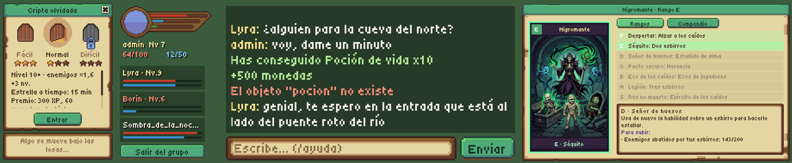</p>
<p align="center">
  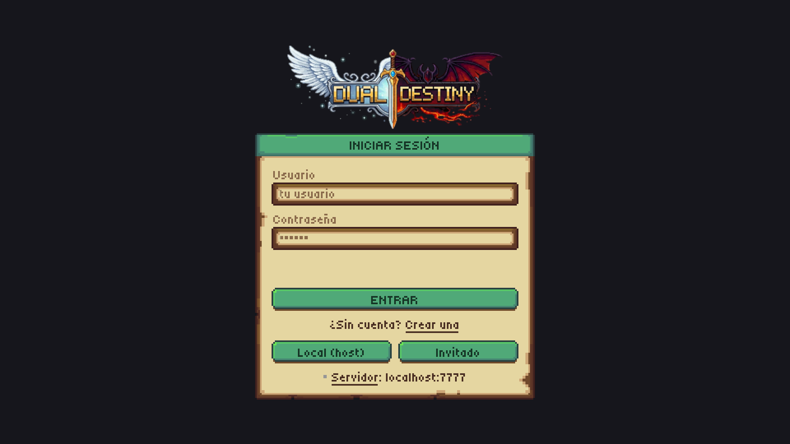
  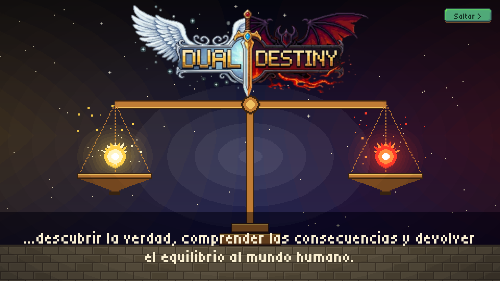
</p>

Toda la interfaz está hecha a mano sobre un lienzo de 480×270 escalado a píxel exacto: inventario, libro de habilidades,
ficha de personaje, bestiario, rasgos, mazmorras, grupos, chat con comandos, tiendas, crafteo, diálogos e intro en vídeo.
En el móvil, joystick y botones táctiles.

## 📊 La dimensión del proyecto

| | |
|---|---|
| **Código C# (Unity)** | 244 scripts · ~46.500 líneas |
| **Servidor (Node.js)** | API REST propia + panel de administración y web (~13.000 líneas de JS/HTML) |
| **Herramientas de arte propias** | 50 generadores en JS (~10.000 líneas): sprites, recortes, música, efectos de sonido |
| **Sprites animados** | 183 especies y personajes, 73 luchadores propios |
| **Efectos visuales** | 129 efectos (inicio · vuelo · impacto) asignables a cualquier habilidad desde el panel |
| **Audio** | 16 temas musicales y 64 efectos de sonido **sintetizados por código** (sin licencias) |
| **Contenido** | 64 NPC, 72 objetos, 43 habilidades, 12 rasgos, misiones con diálogos escritos, mazmorra con 3 dificultades |

## 🏗️ Arquitectura

```
┌─────────────────────────────┐      HTTP (JSON)      ┌──────────────────────────────┐
│  Unity 6 · Mirror             │ ────────────────────▶ │  rpg-server · Node + Express  │
│  ▸ cliente (Android / PC)     │ ◀──────────────────── │  ▸ MongoDB (Mongoose)          │
│  ▸ servidor headless          │                       │  ▸ panel de administración     │
│    autoritativo (mismo build) │                       │  ▸ web del juego               │
└─────────────────────────────┘                       └──────────────────────────────┘
```

- **Servidor autoritativo**: el cliente solo envía intenciones; daño, XP, botín y posición los decide el servidor
  headless de Unity, que lo persiste todo en `rpg-server`. Un jugador con el juego modificado no puede mentir sobre nada.
- **Panel de administración** (`/panel`): NPCs, diálogos con condiciones, misiones, objetos, tiendas, recetas, habilidades
  y rasgos, con vista previa de sprites y efectos. Funciona también en el móvil.
- **Habilidades por piezas**: una habilidad es una forma (proyectil, rayo, línea, área, golpe…) + una lista de efectos
  (daño, veneno, ralentizar, curar, invocar…) + sus efectos visuales. Se diseñan en el panel sin tocar código.
- **Fases privadas**: encuentros de misión y cinemáticas que solo ve el jugador implicado, sobre el mapa compartido.

## 🛠️ Herramientas propias

- **WorldWeaver**: editor de mapas por biomas para Unity. Genera bosques, praderas, costas, cuevas con lava, desiertos e
  invierno a partir de packs de tiles, con más de 60 tests.
- **Generador de sprites**: viste el cuerpo base del jugador con ropa, peinados y colores para crear luchadores nuevos
  con todas sus animaciones.
- **Música y sonido sintetizados**: un secuenciador propio en JS compone los temas (estilo JRPG de 16 bits) y genera
  los efectos, con bucles perfectos.
- **Modo director**: el cliente sigue un guion (teclas, habilidades, comandos) y se graba a sí mismo en segundo plano.
  Así están hechos los vídeos de este escaparate y de la web.
- **Vistas previas en batch**: capturas de cada pantalla de la interfaz sin abrir el editor.

## 💻 Código

El proyecto es privado, pero en **[samples/](samples/)** hay cinco archivos reales para ver cómo está hecho: el modo
director que graba el juego, un rasgo completo con lógica autoritativa en Mirror, las habilidades por piezas del servidor,
el sintetizador de música y el generador de la pasarela de la web.

## 🎮 Juega

- **Web del juego:** [Dual Destiny](http://burnlife.ddns.net:3000/juego/) — historia, rasgos en vídeo y tráiler.
- **Estado:** en desarrollo activo, con versión de pruebas para Android.

> Este repositorio es un **escaparate del proyecto**: el código fuente, el servidor y los recursos del juego son privados.
> Si te interesa el proyecto o quieres colaborar, abre un *issue*.

## 🙌 Créditos

Arte base de personajes, criaturas y tiles de [CraftPix](https://craftpix.net) y otros packs (lista en [CREDITOS.md](CREDITOS.md)). Las ilustraciones de los rasgos, el logo, la música, los sonidos, los luchadores y todo el
código son propios.

---

## 👤 Autor

Creado por **[@morjoos-dev](https://github.com/morjoos-dev)**.

© Todos los derechos reservados. Las imágenes y el código de este repositorio se muestran solo como portfolio: no se
concede licencia de uso, copia ni distribución.

---

<p align="center"><i>Hecho con mucho cariño en ratos libres. Veridia te espera.</i></p>
